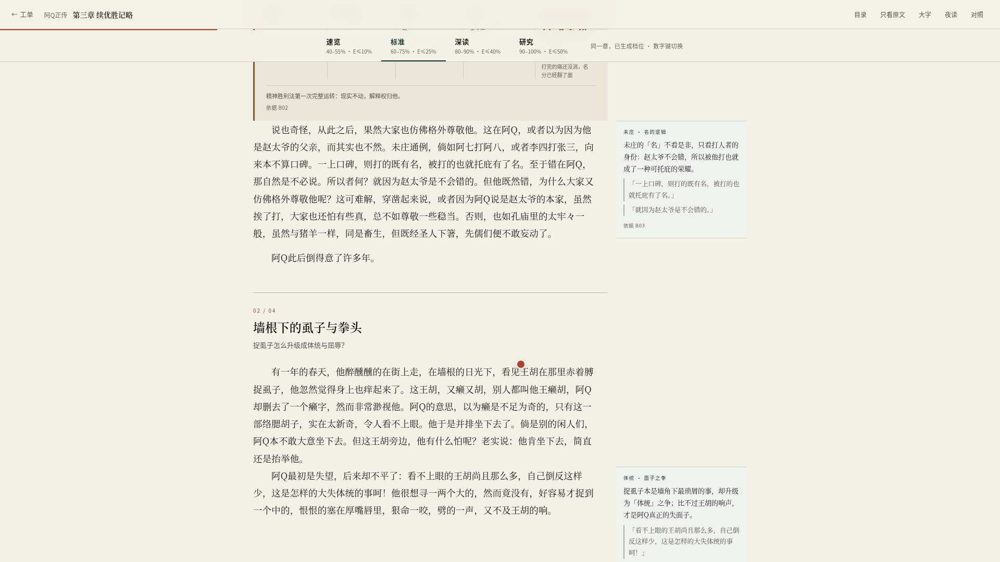

# 静态样例 · 四读

真实跑过的 [book-corpus](../README.md) 实例，把页面脱机导出成静态 HTML，加上一段真机录屏。
没有后端，「点不到」的页面都按死链处理，点了会提示「静态样例 · 这一页没有导出」。

打开 `index.html` 就行（双击，或用任意静态服务器）。




## 里面有什么

| 文件 | 是什么 |
| --- | --- |
| `index.html` | 橱窗：视频、三个技术点、两道工序的架构图、静态页入口 |
| `demo.mp4` | 89 秒录屏，1920×1080，无旁白；背景音乐是 `tools/make_music.py` 合成的原创铺底 |
| `poster.jpg` | 视频封面 |
| `pages/` | 脱机导出的页面（首页、书架、书目、书页、9 张章节工单、8 张读本、一问的答案） |
| `shots/` | 四张截图 |
| `tools/` | 生成脚本 |

## 怎么生成

三个脚本都要在**实例根目录**下跑（这里是 `/home/colaqaq/书库`），并且对应服务开着：

```bash
# 8773 入口 / 8771 四读 / 8765 问书
cd /path/to/book-corpus

# 1. 导出静态页（问书那页从本地会话存档取，不重新调模型）
SESSION_ID=<会话 id> node showcase/tools/export_pages.js

# 2. 真录四段：片头卡、首页、浏览、问书、片尾卡
node showcase/tools/record_demo.js

# 3. 剪成 demo.mp4（顺带出 poster.jpg、合成配乐）
bash showcase/tools/make_video.sh
```

依赖：Playwright（Chromium）、ffmpeg、字体 `Noto Serif CJK SC` / `Noto Sans CJK SC`；
配乐用 numpy 合成（`uv run --with numpy python tools/make_music.py`，没有 uv 就装个 numpy 跑 `python3`）。
中间产物（原始 webm、拼接用的片段）落在 `tools/.build/`，已 gitignore。

- `export_pages.js`：Playwright 打开真页面，等渲染完，取 `page.content()`，重写内链、剥掉外链脚本、
  注入死链提示，把 CSS 抓到 `pages/assets/`。读本页的内联脚本保留，所以静态版**仍能按 1–4 换档**。
- `record_demo.js`：四段各自一个 1920×1080 的录制上下文，页面里注入一个朱红圆点当光标
  （Playwright 不录系统光标），动作节奏按秒排，最后把时间点写进 `marks.json`。
- `make_video.sh`：按 `marks.json` 切段、统一编码、拼起来，最后把合成好的配乐按 -24 LUFS 混进去（视频流原样拷贝，不二次编码）。**全片只有一处剪辑**，见下。
- `make_music.py`：加性合成的一段铺底（D 大调四和弦循环 + 稀疏的「翻页」音 + 卷积混响），
  时长、和弦、力度曲线都是脚本常量，每次生成同一份文件。**不引用任何外部音频素材**，所以不存在授权问题。

## 口径

- 数字：15 本可读、1,973 章原文、629 万字、26,242 段，都是这台机器上的实例实数。
- 四档不是文案，是配额：C 是留下的原文块比例，E 是旁批字数占正文的上限。
  速览 C40–55% · E≤10%，标准 60–75% · E≤25%，深读 80–90% · E≤40%，研究 90–100% · E≤50%。
  超出带宽，门禁 G3 不发布。
- 阿Q正传 9 章里只出了 8 章的读本：第 6 章换了四个模型都被门禁拦下（最后一次报
  `G3 skim C字=0.72；standard C块=0.40；deep C块=0.63`），所以那一章在静态包里没有读本页，
  工单页上的读本链接是死链。这是真事，没有为了好看补一张假页。
- 视频里问的那一问（「阿Q在未庄的『精神胜利法』具体有哪几种表现？」）模型是
  `opencode-go/deepseek-v4.1-flash`，思考档 high，**实际用时 73.8 秒**，答案 8 条引文逐条回查通过、
  置信度高。片中把等待剪掉，在剪点前烧了一句「已快进 · 模型实际用了 73.8 秒」，除此之外没有加速、
  没有补录、没有替换答案。答案页导出的是同一个会话（`SESSION_ID` 就是那次录制产生的）。
- 整台机器只绑 `127.0.0.1`，没有账号、没有 Docker；问书两次模型调用（先把口语问法扩成 4 条检索式，
  带缓存；再据检索到的原文窗口作答），其余全在本地跑。

## 版权

静态样例里**只导出公有领域《阿Q正传》的全文**（鲁迅，9 章）。

视频里那次问书的答案引到了另外三本书，因为答案本身是真实的，保留了：

- 每条引文都是**单句**，属于必要引用的引用；
- 其余书目在页面上只作为书名出现，正文不导出——问书页面里的检索过程（"best_text"、"snippet" 这些字段）
  导出时统一截到开头几十字，首页的「今日日课」那一栏换成一句说明（当期原文有版权）；
- 书库正文（1,955 本，101 MB）在私有仓库 `book-corpus-data`，不进这个仓库。

## 已知局限

- 静态包没有后端：搜索、生成读本、追问都点不动，会提示「静态样例」。
- 只覆盖 B0001 一本书的 9 章；书架上其余 14 本是实拍，点开是死链。
- 视频是 1920×1080、H.264、约 5.7 MB，没有做移动端竖版。
